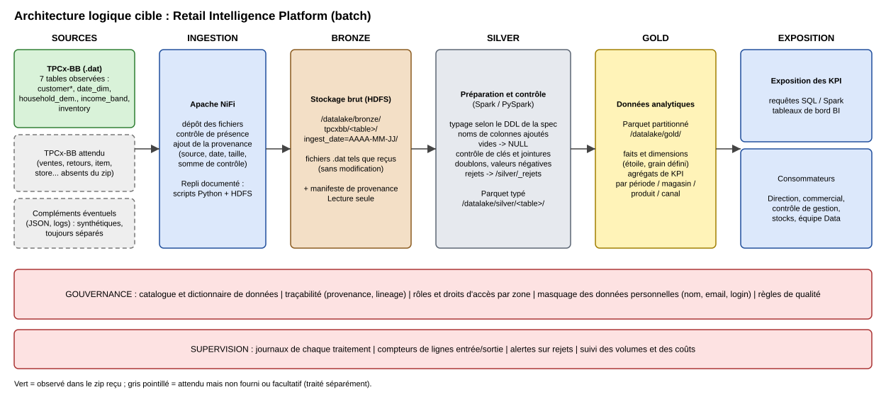

# UC-02 – Architecture logique cible

Il s'agit d'une **conception**. Rien n'est déployé à ce stade (le déploiement commence au Jour 2).

## 1. Sources retenues (issues de l'inventaire UC-01)

| Source | Domaine | Format | Volume constaté | Qualité connue | Usage prévu | Destination |
|---|---|---|---|---|---|---|
| customer | Clients | .dat | 13 Mo, 99 000 lignes | 0,02 % de vides | dimension client | Gold `dim_client` |
| customer_address | Adresses | .dat | 5 Mo, 49 500 lignes | bonne | état/ville du client | Gold `dim_client` |
| customer_demographics | Démographie | .dat | 78 Mo, 1,9 M lignes | 0,026 % de vides | profil du client | Gold `dim_client` |
| household_demographics, income_band | Foyers et revenus | .dat | < 1 Mo | -1 dans `hd_vehicle_count` | tranche de revenu | Gold `dim_client` |
| date_dim | Dates | .dat | 15 Mo, 109 573 lignes | bonne | axe temps | Gold `dim_date` |
| inventory | Stocks | .dat | 398 Mo, 21,8 M lignes | tronqué, 0,026 % de vides | suivi du stock | Gold `fait_stock` |
| store_sales, web_sales, store_returns, web_returns, item, store, warehouse… | Ventes, retours, produits, magasins | attendu | **inconnu** | **non vérifié** | KPI-01 à 07 | Gold `fait_ventes`, `fait_retours` |
| Compléments éventuels (JSON, logs) | Événements | JSON | inconnu | synthétiques | à définir | Zone Bronze séparée `complements/` |

Les données TPCx-BB et les compléments sont stockés dans des dossiers différents. On ne les fusionne jamais silencieusement.

## 2. Les couches

| Couche | Rôle |
|---|---|
| Sources | Fichiers TPCx-BB et éventuels compléments |
| Ingestion | Apache NiFi (batch) : dépose les fichiers en Bronze, enregistre la provenance |
| Bronze (Raw) | Conserve les fichiers **tels que reçus**, avec leur format et leur provenance. Lecture seule |
| Silver | Nettoyage, typage (selon le DDL de la spec), noms de colonnes, vides → NULL, contrôles de clés, mise à l'écart des rejets. Format Parquet |
| Gold | Données prêtes pour les KPI : faits et dimensions, agrégats. Parquet partitionné |
| Exposition | Requêtes SQL/Spark, tableaux de bord pour les décideurs |
| Supervision et gouvernance | Catalogue, traçabilité, accès, qualité, journaux, coûts |

## 3. Description des zones

Les termes Raw/Bronze/Silver/Gold sont des conventions. Ici : **Raw et Bronze sont la même zone** (brut + provenance).

| Zone | Chemin logique | Contenu | Format | Qui y accède | Mise à jour |
|---|---|---|---|---|---|
| Bronze | `/datalake/bronze/tpcxbb/<table>/ingest_date=AAAA-MM-JJ/` | fichiers reçus, inchangés, + manifeste (nom, taille, somme de contrôle, date, source) | `.dat` d'origine | équipe Data (écriture NiFi, lecture seule ensuite) | à chaque dépôt, jamais modifié |
| Silver | `/datalake/silver/<table>/` et `/datalake/silver/_rejets/<table>/` | tables typées, nettoyées, lignes rejetées à part | Parquet | équipe Data | par traitement Spark, rejouable |
| Gold | `/datalake/gold/<sujet>/` | `dim_date`, `dim_client`, `fait_stock`, plus `fait_ventes`, `fait_retours`, `dim_produit`, `dim_magasin` quand les sources existent, et tables de KPI | Parquet partitionné (par année/mois si pertinent) | équipe Data, métier (lecture) | par traitement Spark |

## 4. Modèle dimensionnel initial (Gold)

Schéma en étoile choisi : questions simples côté métier, dimensions peu volumineuses (client 99 000, date 109 573), requêtes avec peu de jointures. Le flocon n'est pas nécessaire ici.

| Table | Grain (une ligne = …) | Clés | Mesures | Statut |
|---|---|---|---|---|
| `dim_date` | un jour | `d_date_sk` | année, mois, jour de la semaine… | construit à partir de `date_dim` (observé) |
| `dim_client` | un client | `c_customer_sk` | adresse, démographie, tranche de revenu | construit à partir de 5 tables (observées) |
| `fait_stock` | un article, un entrepôt, une semaine | `inv_date_sk`, `inv_item_sk`, `inv_warehouse_sk` | `inv_quantity_on_hand` | observé (tronqué) |
| `fait_ventes` | une ligne d'article dans un ticket (magasin) ou une commande (web) | date, article, client, magasin, ticket/commande | quantité, montants, remise | **non vérifié** (tables absentes, spec seulement) |
| `fait_retours` | un article retourné d'un ticket ou d'une commande | date, article, ticket/commande | quantité, montant | **non vérifié** |
| `dim_produit`, `dim_magasin` | un article, un magasin | `i_item_sk`, `s_store_sk` | libellé, catégorie, localisation | **non vérifié** |

## 5. Justification

- Brut conservé en Bronze : rejouabilité et preuve de provenance.
- Silver séparée : tous les contrôles identifiés en UC-01 y sont appliqués (tronqué, vides, -1, clés).
- Gold en étoile : KPI du dictionnaire calculables avec peu de jointures.
- Batch uniquement : les sources sont des fichiers statiques ; aucun besoin de temps réel n'est exprimé. Un flux continu pourrait s'ajouter pour les clics web, mais le besoin est complémentaire.

## 6. Limites de la proposition

- Ce n'est pas testé : seulement une conception logique.
- Le dimensionnement (nombre de nœuds, espace) est impossible tant que le volume du kit complet est inconnu.
- Les faits de ventes et de retours dépendent de tables que nous n'avons pas observées.
