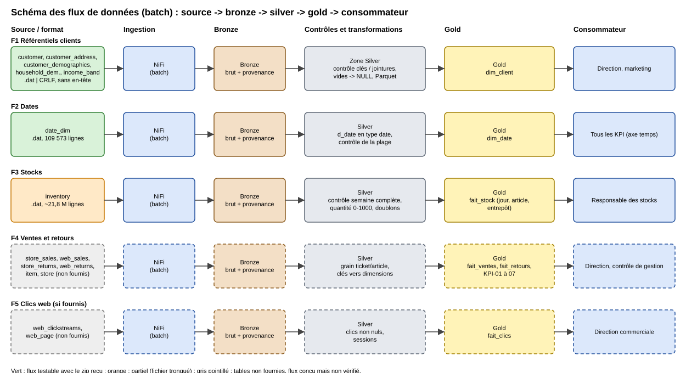

# UC-02 – Schéma des flux de données

## Description des flux

Tous les flux sont en **batch** (fichiers statiques). Le statut dit si le flux a pu être appuyé sur des fichiers observés.

| Flux | Source | Format d'entrée | Ingestion | Zone de destination | Contrôles | Transformations | Résultat | Consommateur | Statut |
|---|---|---|---|---|---|---|---|---|---|
| F1 Référentiels clients | customer, customer_address, customer_demographics, household_demographics, income_band | `.dat`, `\|`, CRLF, sans en-tête | NiFi → HDFS Bronze | Bronze puis Silver, puis Gold | 18/13/9/5/3 champs par ligne ; clé unique ; vides comptés ; clés étrangères sans orphelin ; -1 signalé | ajout des noms de colonnes (DDL), typage, vides → NULL, jointures client + adresse + démographie + foyer + tranche | `dim_client` en Parquet | Direction commerciale, marketing | Observé (jointures vérifiées) |
| F2 Dates | date_dim | `.dat` | idem | Bronze → Silver → Gold | 28 champs ; `d_date_sk` unique ; plage 1900-2199 | `d_date` texte → date, colonnes utiles | `dim_date` | tous les KPI | Observé |
| F3 Stocks | inventory | `.dat`, ≈ 400 Mo | idem (gros fichier, découpage par NiFi) | Bronze → Silver → Gold | 4 champs ; **lignes incomplètes rejetées** ; 90 000 lignes par date (18 000 × 5) ; quantité 0-1 000 ; pas de doublon sur (date, article, entrepôt) ; dates reliées à `date_dim` | typage, partition par année/mois | `fait_stock` | Responsable des stocks | Partiel (fichier tronqué) |
| F4 Ventes et retours | store_sales, web_sales, store_returns, web_returns, item, store | `.dat` attendu | idem | Bronze → Silver → Gold | à définir sur les vraies données : unicité ticket/commande + article, clés vers dimensions, montants ≥ 0 ? | grain ligne d'article, rattachement aux dimensions, calcul des KPI-01 à 07 | `fait_ventes`, `fait_retours`, KPI | Direction, contrôle de gestion, magasins | **Non vérifié** (tables absentes) |
| F5 Navigation web | web_clickstreams, web_page | `.dat` attendu | batch ; flux continu possible plus tard (hors périmètre) | Bronze → Silver → Gold | `wcs_user_sk` et `wcs_item_sk` peuvent être vides (spec) | exclure les clics sans article, créer des sessions | `fait_clics` | Direction commerciale | **Non vérifié** ; complémentaire |
| F6 Compléments éventuels | JSON, logs | JSON | NiFi vers `bronze/complements/` | Bronze séparé | provenance et mention « synthétique » obligatoires | selon le cas | à définir | à définir | Non applicable (aucun reçu) |

## Batch ou continu ?

Le besoin décrit (pilotage, comparaison de périodes) est du **batch** : traitement quotidien ou hebdomadaire. Un traitement en continu n'est pas justifié aujourd'hui. Il le deviendrait pour surveiller les clics web en temps réel, ce qui n'est pas demandé (besoin « complémentaire »).

## Ordre d'exécution

1. Ingestion en Bronze (NiFi) + manifeste.
2. Contrôles de présence et de structure.
3. Silver : typage, nettoyage, rejets.
4. Gold : dimensions d'abord (`dim_date`, `dim_client`), puis faits, puis KPI.
5. Publication et journalisation (lignes entrée / sortie / rejetées).

Une erreur de contrôle sur un fichier bloque seulement ce fichier : les lignes rejetées sont écrites à part et le traitement peut être rejoué depuis Bronze.
