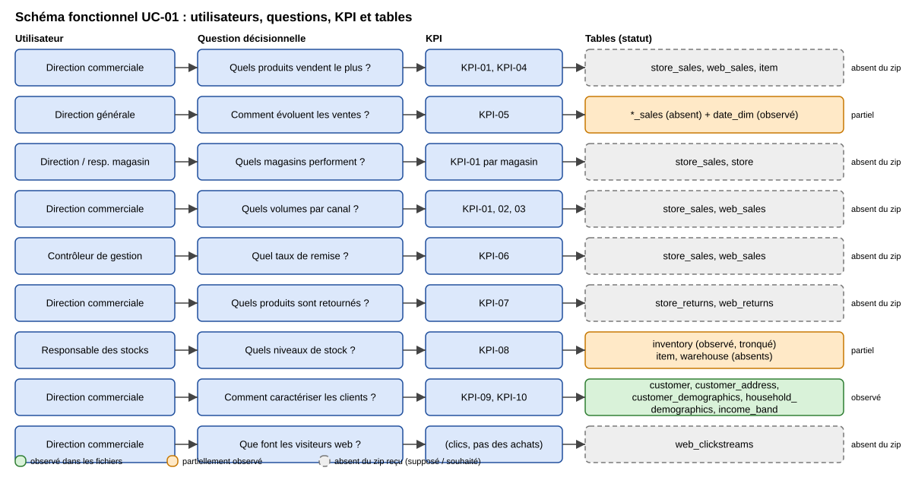

# UC-01 – Cadrage métier

Retail Intelligence Platform – TP J1 – Mohammed Mosleh

## 1. Contexte

Retail Intelligence est une enseigne de distribution avec plusieurs canaux de vente (magasin et web). Les directions commerciale et financière veulent des indicateurs fiables pour piloter les ventes, comparer les magasins et suivre l'activité dans le temps. Les données sont aujourd'hui dans des systèmes différents (ventes, produits, clients, magasins, stocks).

Notre rôle : comprendre le besoin, vérifier les données qu'on a vraiment, puis proposer une architecture (UC-02).

## 2. Les données reçues

Le formateur a fourni un seul fichier de données : `retail_project.zip` (120 441 614 octets), plus le cours, le TP, le projet fil rouge et la spécification TPCx-BB v1.7.0 (lien tpc.org).

**Point important : le zip est tronqué.** `unzip` répond « End-of-central-directory signature not found ». J'ai récupéré les fichiers lisibles en lisant les en-têtes un par un (`UC01_preuves/recuperation_zip.py`). On obtient 7 tables sur la vingtaine citées dans la spec et dans le projet. Les tables de ventes, de retours, `item`, `store` et la navigation web ne sont pas dedans.

| Information | Valeur | Statut |
|---|---|---|
| Nom du kit | `retail_project.zip`, dossier `retail_project/data/` | Vérifié |
| Jeu de données | TPCx-BB (TPC Express Big Bench), jeu synthétique | Vérifié (cours, TP) |
| Version de la spec consultée | 1.7.0 | Vérifié (PDF tpc.org) |
| Version du kit distribué | non communiqué | À valider |
| Provenance | fourni par le formateur ; le projet fil rouge cite un environnement de génération avec les chemins HDFS `/user/root/benchmarks/bigbench/data` | Vérifié (projet) / génération non vérifiée |
| Date de mise à disposition | non communiqué | À valider |
| Source de téléchargement | non communiqué | À valider |
| Format des fichiers | texte `.dat`, séparateur `\|`, sans en-tête, fin de ligne CRLF | Vérifié |
| Nombre de fichiers | 7 (un par table) | Vérifié |
| Volume total constaté | 510 172 547 octets (≈ 510 Mo) décompressé | Vérifié |
| Outil de génération | non communiqué (PDGF cité dans le TP « selon kit ») | À valider |
| Adaptations du formateur | non communiqué | À valider |

Je n'ai pas déduit de version à partir du nom des fichiers, comme demandé dans le TP.

Comme il n'y a pas d'en-tête dans les fichiers, les noms de colonnes viennent du DDL Hive de la spec (annexe sur la création des tables), dans l'ordre. Le nombre de colonnes observé correspond pour les 7 tables (voir qualification).

## 3. Utilisateurs

| Profil | Responsabilité | Priorité |
|---|---|---|
| Direction générale | Vision consolidée, évolution de l'activité | Indispensable |
| Direction commerciale | Performance des ventes et des produits | Indispensable |
| Responsable de magasin | Suivi de son magasin | Utile |
| Contrôleur de gestion | Indicateurs financiers, comparaisons | Utile |
| Responsable des stocks | Disponibilité, mouvements de stock | Utile |
| Équipe Data | Intégration, qualité, mise à disposition | Indispensable |

## 4. Ce que les données permettent vraiment

On distingue ce que l'entreprise veut, ce que les fichiers reçus permettent, et ce qui demande une source en plus.

| Question initiale du TP | Couverte par le zip reçu ? | Pourquoi |
|---|---|---|
| Quels produits vendent le plus ? | **Non** | `store_sales`, `web_sales` et `item` absents |
| Évolution des ventes dans le temps | **Non** (axe temps seulement) | `date_dim` est là (1900 à 2199) mais pas les ventes |
| Quels magasins performent ? | **Non** | `store` et `store_sales` absents |
| Volumes de ventes par canal | **Non** | tables de ventes absentes |
| Quels produits sont retournés ? | **Non** | tables de retours absentes |
| Caractériser les clients | **Oui** | `customer`, adresses, démographie, foyers, tranches de revenu : jointures vérifiées |
| Niveaux de stock | **Partiel** | `inventory` présent mais tronqué ; `item` et `warehouse` absents (pas de libellés) |
| Comportement web | **Non** | `web_clickstreams` absent (et un clic n'est pas un achat) |

Les besoins marqués « Non » restent des besoins non couverts. Je ne les ai pas remplacés par des valeurs inventées. Ils sont conçus dans UC-02 en supposant que les tables arriveront, et marqués « non vérifié ».

## 5. Schéma fonctionnel

