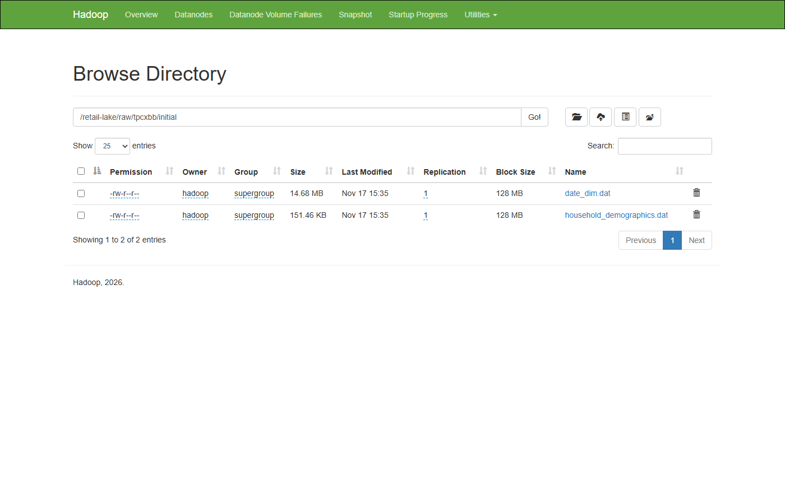

# UC-03 – Commandes HDFS, dépôt et vérifications

Les commandes sont dans `ingestion/scripts/uc03_hdfs.sh` ; les sorties complètes et datées sont dans `UC03_preuves/hdfs/` (annexe).

## Commandes principales et résultats

| Commande | Résultat observé |
|---|---|
| `hadoop version` | Hadoop 3.5.0 |
| `jps` (NameNode, DataNode) | processus `NameNode` et `DataNode` actifs |
| `hdfs dfsadmin -report` | 1 DataNode actif, capacité 1006,85 Go, 0 bloc manquant |
| `hdfs dfs -ls /` | vide au départ |
| `hdfs dfs -mkdir -p /retail-lake/...` (8 répertoires) | code retour 0 pour chacun |
| `hdfs dfs -ls -R /retail-lake` | 11 répertoires |
| `hdfs dfs -du -h /retail-lake` | 0 partout avant dépôt |
| `hdfs dfs -put` des 2 fichiers dans `raw/tpcxbb/initial` | code retour 0 |
| `hdfs dfs -ls -h`, `-du -h`, `-stat` | 151,46 Ko et 14,68 Mo, réplication 1, bloc 134 217 728 octets (128 Mo) |
| `hdfs dfs -cat ... \| head -n 3` | lecture des 3 premières lignes de `household_demographics.dat` |
| `hdfs fsck /retail-lake/raw/tpcxbb/initial -files -blocks -locations` | HEALTHY, 2 fichiers, 2 blocs, 1 DataNode, 0 bloc corrompu |
| `hdfs dfs -get` puis `sha256sum` et `cmp` | empreintes identiques à la source, `IDENTIQUE` pour les 2 fichiers |

## Vérifications avant et après dépôt

Avant : chemin local, nom, format (texte `|`), taille, nombre de lignes et de colonnes, lisibilité (`head`), empreinte SHA-256 (voir Inventaire). Après : présence dans les bons répertoires, taille cohérente (`155100` et `15395800` octets), accessibilité (`-cat`, `-get`), permissions `-rw-r--r--` propriétaire `hadoop` groupe `supergroup`, source locale conservée (`ls -l /data/tpcxbb`).

## Difficultés rencontrées

| Difficulté | Cause | Solution |
|---|---|---|
| `mkdir /data/tpcxbb` créait `C:/Program Files/Git/data/tpcxbb` dans le conteneur | Git Bash convertit les chemins `/data/...` en chemins Windows | `MSYS_NO_PATHCONV=1`, dossier parasite supprimé |
| `mkdir /data` refusé | L'utilisateur du conteneur (`hadoop`) n'a pas les droits sur `/` | `docker exec -u root` puis `chown hadoop` |
| Heures différentes entre mes journaux et ceux de Hadoop | Mes scripts utilisent l'heure de Paris (UTC+1), Hadoop est en UTC | Noté dans la fiche d'environnement |
