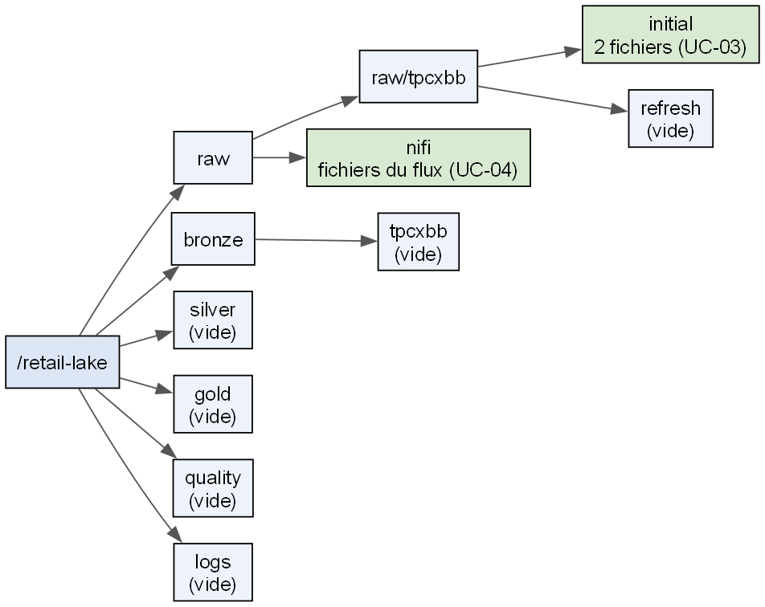
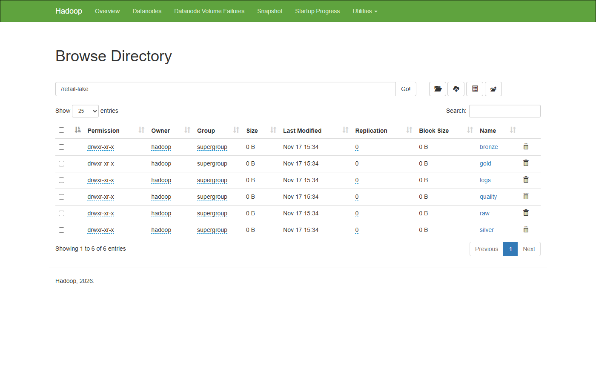

# UC-03 – Arborescence du Data Lake dans HDFS

Arborescence créée avec `uc03_hdfs.sh` (liste complète dans `UC03_preuves/hdfs/commandes_hdfs.txt`, capture `UC03_preuves/data_lake/explorer_retail_lake.png`) :

```
/retail-lake/
  raw/
    tpcxbb/initial/     dépôt manuel UC-03 (household_demographics.dat, date_dim.dat)
    tpcxbb/refresh/     réservé aux livraisons suivantes
    nifi/               dépôt du flux UC-04 (destination distincte pour ne rien écraser)
  bronze/tpcxbb/        données reprises de raw, sans transformation métier
  silver/               données nettoyées (Jour 3)
  gold/                 données prêtes pour l'analyse (Jour 3)
  quality/              résultats des contrôles qualité
  logs/                 journaux d'ingestion
```





Seuls `raw/tpcxbb/initial` et `raw/nifi` contiennent des fichiers à ce stade. `bronze`, `silver`, `gold`, `quality`, `logs` et `raw/tpcxbb/refresh` sont vides : je les ai seulement créés.

## Pourquoi cette organisation

- **Conserver les sources (Raw)** : on peut toujours rejouer un traitement ou prouver ce qui a été reçu. Raw n'est jamais modifié.
- **Raw et Bronze** : Raw = la copie exacte du fichier reçu. Bronze = même contenu rangé selon les conventions du lake, prêt à être lu par Spark (le format Parquet vient plus tard). Aucune règle métier dans Bronze.
- **Silver** : données nettoyées et typées. **Gold** : données modélisées pour répondre aux questions du Jour 1 (KPI).
- **`quality` et `logs` séparés** des données métier : on peut donner l'accès aux résultats de contrôle sans exposer les données, et les journaux n'alourdissent pas les zones de données.
- **Provenance** : le nom du dossier dit l'origine (`tpcxbb`, `initial`/`nifi`), les empreintes SHA-256 sont dans `la section Inventaire`, et NiFi garde les événements de provenance (`provenance.md`).

## Convention de nommage proposée (CO-02)

`/retail-lake/<zone>/<source>/<lot>/<table>.dat` avec `<lot>` = `initial` ou `refresh` (puis `refresh/AAAA-MM-JJ` s'il y a plusieurs livraisons). Le nom de fichier reste celui d'origine pour garder le lien avec le kit. Il n'y a pas de date dans les noms actuels car le kit n'en fournit pas.
