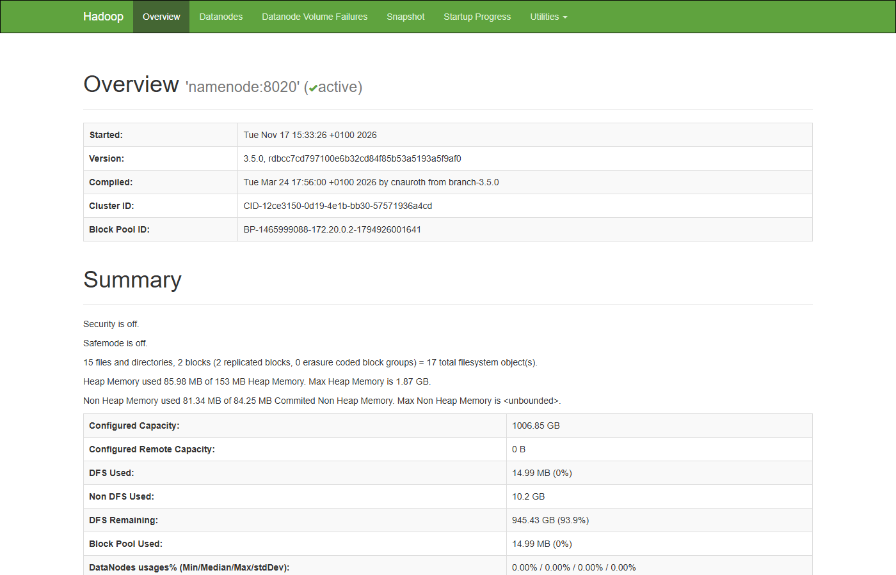
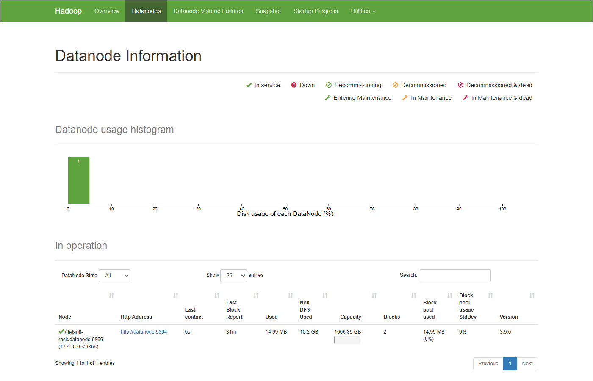

# UC-03 – Fiche d'environnement technique et fiche Hadoop/HDFS

Relevé fait le 17/11/2026 avec `ingestion/scripts/uc03_hdfs.sh` (sortie complète : `UC03_preuves/environnement/environnement.txt`).

## Environnement

| Élément | Valeur relevée |
|---|---|
| Poste | Windows 11, Docker Desktop (moteur WSL2) |
| Conteneur NameNode et DataNode | `apache/hadoop:3.5.0`, Ubuntu 24.04.4 LTS, Java Temurin 17.0.18, Python 3.12.3 |
| Conteneur NiFi | `apache/nifi:2.12.0`, Debian 12, Java 21.0.12 (le TP prévoit Ubuntu : écart assumé, voir plus bas) |
| Hadoop | 3.5.0 (compilé le 24/03/2026), configuration dans `/opt/hadoop/etc/hadoop` |
| NiFi | 2.12.0, interface `https://localhost:8443/nifi`, connexion par identifiant unique généré par variables d'environnement |
| Réplication | 1 (un seul DataNode) |
| Utilisateur HDFS | `hadoop` (superutilisateur), sécurité Kerberos désactivée (« Security is off ») |

Les versions sont celles de la matrice du TP (Hadoop 3.5.0, NiFi 2.12.0, Java 17 et 21). Je n'ai pas installé Ubuntu, `apt` ni les tar.gz : j'ai utilisé les images officielles Apache. Les fuseaux horaires diffèrent : Hadoop et NiFi journalisent en UTC, mes scripts en heure de Paris (UTC+1).

Captures : `UC03_preuves/environnement/namenode_overview.png` et `namenode_datanodes.png`, conteneurs : `docker_ps.txt`.

## Fiche Hadoop / HDFS

- **État** : `jps` montre `NameNode` dans le conteneur namenode ; `hdfs dfsadmin -report` donne 1 DataNode actif (`Live datanodes (1)`), 1006,85 Go de capacité configurée, 0 bloc manquant.
- **Mode** : **mono-nœud pseudo-distribué**, environnement pédagogique, pas un cluster de production hautement disponible.
- **NameNode** : garde les métadonnées (arborescence, droits, liste des blocs et leur emplacement). Il ne stocke pas les données.
- **DataNode** : stocke les blocs et répond au NameNode par des signaux réguliers. Ici le fichier `date_dim.dat` est dans 1 bloc sur le DataNode `172.20.0.3`.
- **Taille de bloc** : 128 Mo (vu dans l'interface web). Les deux fichiers déposés tiennent chacun dans 1 bloc.
- Le formatage du NameNode (`hdfs namenode -format`) n'a pas été lancé par moi : l'image prépare le répertoire du NameNode au démarrage (variable `ENSURE_NAMENODE_DIR`).

## Écart avec le TP

Le TP décrit une installation sur Ubuntu avec `/opt/hadoop` et `/opt/nifi`. Ici : conteneurs Docker, pas de `nifi.sh start`, pas d'ordre `start-dfs.sh`. L'ordre de démarrage respecté est HDFS puis NiFi (`depends_on` dans le compose).
