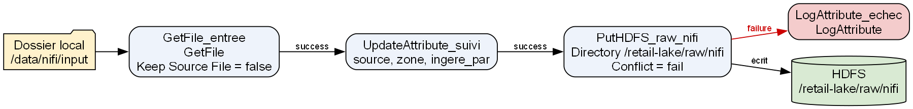
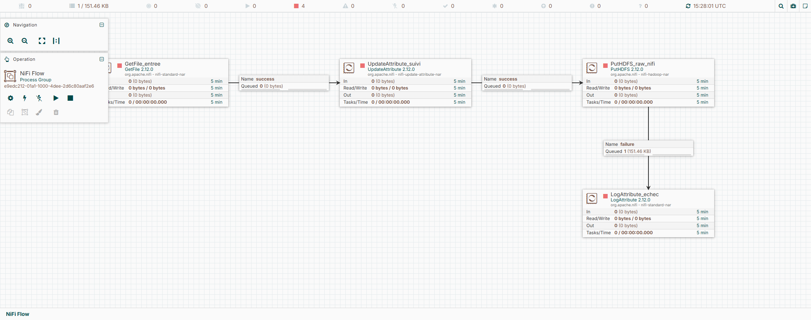
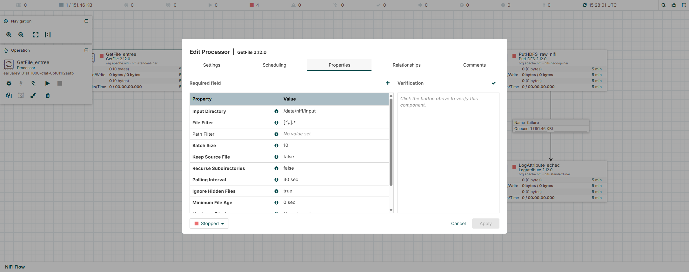
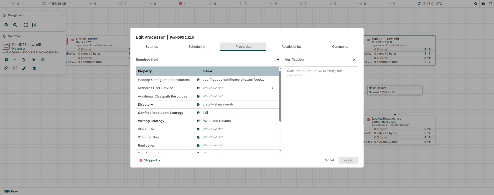

# UC-04 – NiFi : découverte, flux, erreurs

## Découverte de NiFi (relevé réel)

- Version : **2.12.0** (`/nifi-api/flow/about`), adresse `https://localhost:8443/nifi`, authentification par identifiant unique, accès local, certificat auto-signé.
- L'image officielle propose 294 types de processeurs. **PutHDFS n'en fait pas partie** : les NAR Hadoop ne sont pas dans la distribution. J'ai ajouté les deux NAR officiels Apache `nifi-hadoop-nar` et `nifi-hadoop-libraries-nar` 2.12.0, téléchargés sur Maven Central (SHA-1 vérifié) et copiés dans `nar_extensions` (script `uc04_installer_nar.sh`). Après chargement, 9 processeurs HDFS apparaissent, dont PutHDFS.

| Concept | Rôle |
|---|---|
| FlowFile | Unité qui circule : contenu du fichier + attributs (nom, chemin, taille, uuid) |
| Processor | Fait une opération (lire, modifier un attribut, écrire dans HDFS) |
| Connection | Lien entre deux processeurs, avec une file d'attente, par relation (success, failure) |
| Process Group | Conteneur qui regroupe des composants. Ici le flux est dans le groupe racine |
| Controller Service | Service partagé (connexion, configuration). Aucun n'a été nécessaire ici |
| Provenance Repository | Journal des événements de chaque FlowFile (réception, modification, envoi) |

## Flux réalisé

```
GetFile_entree --success--> UpdateAttribute_suivi --success--> PutHDFS_raw_nifi --failure--> LogAttribute_echec
 /data/nifi/input             source, zone, ingere_par           /retail-lake/raw/nifi
```

PutHDFS : `Hadoop Configuration Resources` = `core-site.xml` et `hdfs-site.xml` montés dans `/opt/hadoop-conf`, `Directory` = `/retail-lake/raw/nifi`, `Conflict Resolution Strategy` = `fail` (n'écrase jamais), relation `success` auto-terminée, `failure` reliée à LogAttribute. GetFile : `Keep Source File` = false.



Export : `UC04_preuves/configuration/flux_j2.json`. Le flux est créé et lancé avec l'API REST de NiFi (`uc04_nifi.py`, `uc04_run.py`), pas en cliquant dans l'interface. Ensuite j'ai ouvert l'interface NiFi dans un navigateur piloté par script (Selenium, Edge) pour prendre les captures ci-dessous : elles montrent l'état réel de l'instance.

**Interface, flux et compteurs** (`UC04_preuves/execution/canvas_flux_compteurs.png`) : version 2.12.0 visible sur chaque processeur, 4 processeurs arrêtés après l'exécution, compteurs sur 5 min (327 octets lus et écrits, du 2e run), file `failure` avec 1 FlowFile de 151,46 Ko (le doublon refusé du test).



**Propriétés de GetFile** (`UC04_preuves/configuration/getfile_proprietes.png`) : `Input Directory` = `/data/nifi/input`, `Keep Source File` = false, `Recurse Subdirectories` = false, `Polling Interval` = 30 sec (valeur par défaut).



**Propriétés de PutHDFS** (`UC04_preuves/configuration/puthdfs_proprietes.png`) : configuration Hadoop `/opt/hadoop-conf/core-site.xml,...`, `Directory` = `/retail-lake/raw/nifi`, `Conflict Resolution Strategy` = fail.



**Relations** : `success` de GetFile et UpdateAttribute va au processeur suivant ; `success` de PutHDFS est auto-terminée (le dépôt est fini) ; `failure` de PutHDFS est reliée à LogAttribute pour ne pas perdre le FlowFile.

**Scénario de test** : un fichier de test (copie de `household_demographics.dat`) placé dans `/data/nifi/input`, démarrage de PutHDFS puis UpdateAttribute puis GetFile, observation des compteurs, vérification dans HDFS.

Résultat observé (`UC04_preuves/execution/execution_flux.txt`) : 1 FlowFile (`household_demographics.dat`, 155 100 octets) lu par GetFile, attributs ajoutés, **fichier écrit par PutHDFS** dans `/retail-lake/raw/nifi` (155 100 octets, `-rw-r--r--` `hadoop`). `sha256sum` du fichier relu depuis HDFS = celui de la source. Le dossier d'entrée est vide ensuite.
Le script ne suit pas l'ordre du TP à la lettre : j'ai démarré PutHDFS, puis UpdateAttribute, puis GetFile.

## Tableau des erreurs

| Erreur / difficulté | Cause | Correction / résultat |
|---|---|---|
| GetFile invalide : « Directory does not exist » (test volontaire, `UC04_preuves/erreurs/test_erreur.txt`) | `Input Directory` = `/data/nifi/inexistant` | Remise de `/data/nifi/input`, le processeur redevient VALID |
| Doublon refusé (test volontaire, `UC04_preuves/erreurs/test_conflit_doublon.txt`) | Fichier de même nom déjà dans HDFS, stratégie `fail` | PutHDFS : « routing to failure because file with same name already exists ». Le FlowFile attend en file `failure`, HDFS n'est pas modifié |
| PutHDFS absent de l'image | NAR Hadoop non fournis | Ajout des 2 NAR Apache (voir plus haut) |
| `docker cp` créait `C:/Program Files/Git/data` dans le conteneur | Git Bash convertit les chemins `/data/...` | `MSYS_NO_PATHCONV=1` (dans `lib.sh`), dossier parasite supprimé |
| `mkdir /data` refusé pour l'utilisateur `hadoop` | Droits du conteneur | `docker exec -u root` puis `chown` |
| Les NAR copiés dans `extensions/` n'étaient pas chargés | Le dossier de chargement automatique est `nar_extensions` (`nifi.properties`) | Déplacés dans `nar_extensions` |
| Une relance juste après le test d'erreur n'a rien lu | Cause probable : `Polling Interval` de GetFile = 30 s (vu sur la capture), non vérifiée | Relance avec 25 s d'attente : OK |

Le premier test d'erreur est un échec de **configuration** (validation du processeur) ; le second (doublon) est un échec à l'**exécution**. Je n'ai pas testé le retrait des droits de lecture du fichier. Le FlowFile du test de doublon est resté dans la file `failure` (LogAttribute est pénalisé par NiFi avant de le traiter).

## Essai préalable sans PutHDFS

Avant d'ajouter les NAR, j'ai fait un essai GetFile → UpdateAttribute → PutFile, avec un dépôt HDFS par `hdfs dfs -put` (solution de repli). Ses preuves sont dans `UC04_preuves/erreurs/essai_sans_puthdfs/` et le script `uc04_repli_hdfs.sh`. Ce n'est plus le flux retenu.
