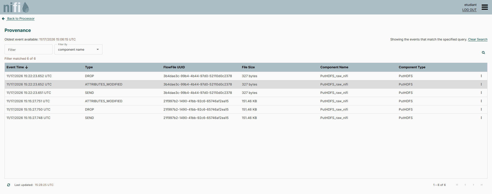
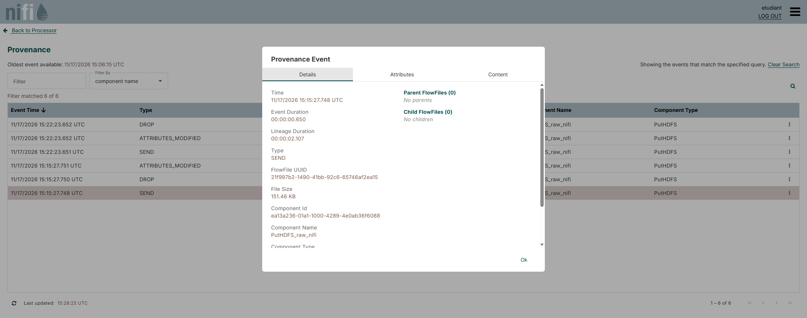

# UC-04 – Provenance et traçabilité

## Fichiers déposés (HDFS)

| Fichier | Origine | Chemin HDFS | Méthode | SHA-256 vérifié |
|---|---|---|---|---|
| `household_demographics.dat` | `retail_project.zip` du formateur | `/retail-lake/raw/tpcxbb/initial/` | `hdfs dfs -put` (UC-03) | oui, relu depuis HDFS puis comparé |
| `date_dim.dat` | idem | `/retail-lake/raw/tpcxbb/initial/` | `hdfs dfs -put` (UC-03) | oui |
| `household_demographics.dat` (copie de travail) | idem | `/retail-lake/raw/nifi/` | **NiFi, PutHDFS** (UC-04) | oui, empreinte identique à la source |

La source d'origine n'est pas modifiée : les fichiers sont copiés dans les conteneurs. Dans le flux NiFi, le dossier d'entrée est vidé (Keep Source File = false), mais il ne contient qu'une copie.

## Événements de provenance NiFi

Relevés par l'API (`UC04_preuves/provenance/provenance_evenements.json`, lisibles dans `UC04_preuves/execution/execution_flux.txt`). FlowFile `21f997b2-1490-41bb-92c6-65746af2ea15`, 151,46 Ko :

| Id | Heure (UTC) | Événement | Composant |
|---|---|---|---|
| 4 | 15:15:25.646 | RECEIVE | GetFile_entree |
| 5 | 15:15:25.669 | ATTRIBUTES_MODIFIED | UpdateAttribute_suivi |
| 6 | 15:15:27.748 | SEND | PutHDFS_raw_nifi |
| 7 | 15:15:27.751 | ATTRIBUTES_MODIFIED | PutHDFS_raw_nifi |
| 8 | 15:15:27.750 | DROP | PutHDFS_raw_nifi |

(Les ids 0 à 3 appartiennent à l'essai sans PutHDFS, dans `essai_sans_puthdfs/`. L'événement 8 est horodaté 1 ms avant le 7 : je recopie l'ordre donné par l'API.)

Captures de l'interface NiFi (écran Provenance de PutHDFS) : liste des événements puis détail de l'événement SEND (FlowFile `21f997b2…`, durée de l'événement 0,650 s, aucun parent ni enfant).

La liste contient aussi 3 événements du 2e run (`3b4dae3c-…`, 327 octets, `income_band.dat`, fait pour les compteurs de la capture). Le fichier `provenance_evenements_apres_run2.json` contient tous les événements (y compris ceux du doublon refusé, FlowFile `b23b5c7a-…`).

Ces événements permettent de reconstituer le parcours : le fichier est entré par GetFile, des attributs de suivi (`source=tpcxbb`, `zone=raw`, `ingere_par=nifi_j2`) ont été ajoutés, PutHDFS l'a envoyé dans HDFS (SEND), puis le FlowFile a été terminé (DROP). Le même identifiant relie toutes les étapes, ce qui relie un fichier à son traitement.
